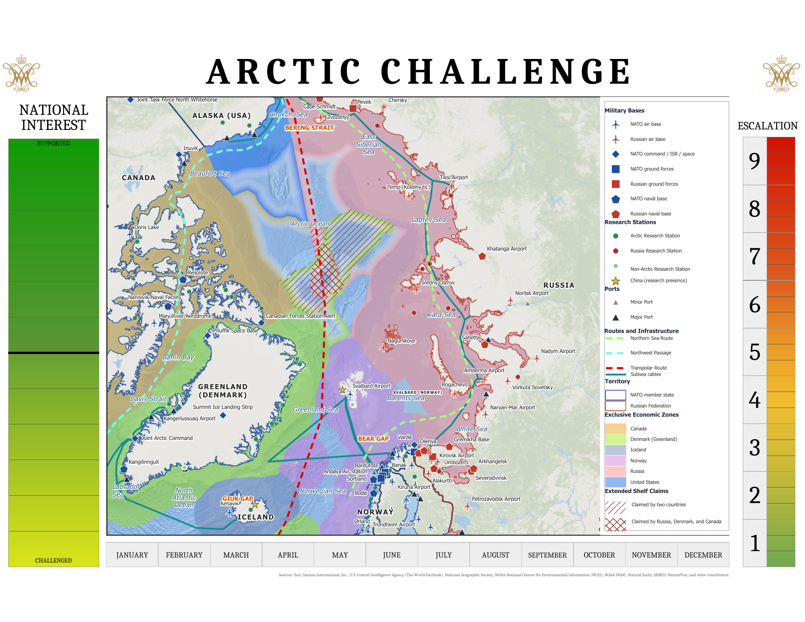

# ARCTIC-CHALLENGE-2.0
Analytical map and game board of the Arctic Ocean and territories, used for wargaming the ARCTIC CHALLENGE 2.0 at William &amp; Mary. 
# ARCTIC CHALLENGE 2.0: Strategic Wargaming Geospatial Analysis

## Project Overview
This project contains the geospatial data layers, custom symbology, and analytical map products developed for the **ARCTIC CHALLENGE 2.0** strategic simulation at William & Mary. The map was designed to provide players, adjudicators, and national security observers with real-time spatial awareness of UNCLOS EEZ information, Russian subsea telecommunications cables, and shipping corridors in the Arctic. Glasl's  model was used for the facilitator to track levels of escalation throughout the game, while the national interest spectrum was used to determine logical effectiveness of actor moves compared against counterarguments presented by other actors.

## Key Objectives
* **Operational Terrain Visualization:** Synthesize bathymetric, ice-extent, and regional infrastructure data to model movement corridors in the Arctic theater.
* **Decision-Support Cartography:** Create a clear, readable cartographic layout capable of supporting rapid operational adjudication during multi-turn wargame exercises.
* **Data Standardization:** Unify disparate open-source spatial datasets into a clean, consistent coordinate system suitable for polar analysis.

---

## Geospatial Methodology & Workflow

1. **Coordinate Reference System (CRS) Selection:**
   * Projected all spatial layers into **WGS 1984 Arctic Polar Stereographic** (or specify your exact projection) to eliminate high-latitude distortion and preserve accurate distance/area measurements across polar routes.
2. **Data Sourcing & Vector Hygiene:**
   * Sourced open-source EEZ, port, airfield, and subsea cable informations from Esri; Garmin International, Inc.; U.S. Central Intelligence Agency (The World Factbook); National Geographic Society: NOAA National Centers for Environmental Information (NCE); NOAA NGDC; Natural Earth; GEBCO; NaturalVue; and other contributors.
   * Performed topology cleanup, attribute table standardization, and spatial joins to link logistical capacity metrics to key regional nodes.
3. **Custom Military & Strategic Symbology:**
   * Developed custom point and polygon symbology to distinguish contested maritime zones, exclusive economic zones (EEZs), and critical infrastructure assets.
4. **Layout & Export:**
   * Designed a multi-frame cartographic layout featuring inset maps for key strategic chokepoints (e.g., the GIUK Gap and Bering Strait), scale bars, and clear legend hierarchies.

---

## Tech Stack & Tools
* **GIS Software:** ArcGIS Pro (v3.x)
* **Spatial Analysis Tools:** Project, Clip, Buffer, Spatial Join, Dissolve
* **Data Formats:** File Geodatabase (`.gdb`), Shapefiles (`.shp`), Project Package (`.mpkx`)

---

## Repository Structure
* `exports/` — High-resolution `.png` and `.pdf` exports of the final wargaming map layouts for immediate viewing.
* `package/` — Portable ArcGIS Project Package (`.mpkx`) containing consolidated layers and symbology.
* `scripts/` — Python scripts used for data cleaning and preprocessing.

---

*Disclaimer: All scenarios, force dispositions, and analytical overlays depicted in this repository are simulated for academic wargaming purposes and rely exclusively on open-source data.*
